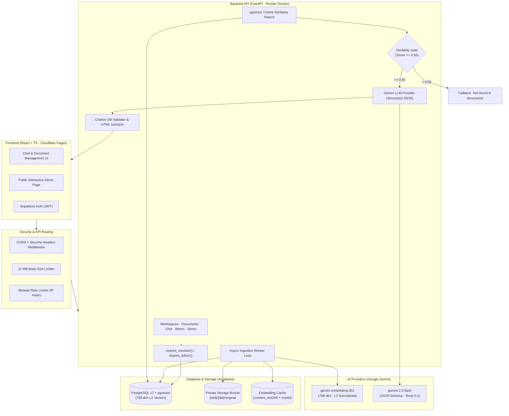

# Company Knowledge & SOP Assistant

A production-grade, grounded enterprise retrieval-augmented generation (RAG) application designed to ingest internal company handbooks, travel policies, and standard operating procedures (PDF, DOCX, TXT) and provide verified answers strictly backed by exact citations—with zero hallucinations and strict multi-tenant isolation.

---

## Architecture Overview



---

## Core Capabilities

1. **Strictly Grounded Answers:** The LLM generates answers exclusively using retrieved chunks formatted inside `<sources>` tags, treating source content as untrusted data to defend against prompt injection.
2. **Zero-Hallucination Retrieval Gate:** If the top retrieved chunk similarity score falls below `0.50`, the system automatically returns a standardized fallback ("I couldn't find this in the uploaded documents") without calling the generative LLM, conserving quota and preventing fabrication.
3. **Verified DB-Backed Citations:** Citations (`[1]`, `[2]`) are built directly from PostgreSQL chunk metadata (page numbers, section titles, and 300-char excerpts). Hallucinated or invalid source indices are stripped before response delivery.
4. **Multi-Tenant Isolation:** Every query strictly enforces `workspace_id`. Non-members receive `HTTP 404` (not 403) to eliminate workspace existence leakage.
5. **Robust Ingestion Pipeline:** Supports streamed upload validation (magic bytes, 10 MB limit, DOCX zip-bomb defense, encrypted PDF detection), background job queueing with stale lock recovery, and a content-hash embedding cache that avoids redundant API calls.
6. **Public Demo Mode:** Includes a read-only demo workspace pre-seeded with synthetic Acme Corp SOPs, IP-hash daily quotas (15 questions/day), short-TTL answer caching, and zero conversation persistence.

---

## Limitations & Free-Tier Operational Notes

This application is engineered to operate seamlessly within free hosting tiers (Render free web service, Supabase free PostgreSQL, Cloudflare Pages, Google AI Studio free tier). The following mitigations are built into the codebase:

| Limitation | Impact | Mitigation Built into Architecture |
|---|---|---|
| **Render Web Service Sleep** | Free instance sleeps after 15 min idle; cold start is ~50s. | Frontend pings `/api/v1/health` on load and displays an informative "Waking server…" banner. External keepalive pingers maintain uptime during peak hours. |
| **Ephemeral Filesystem & RAM** | 512 MB memory limit on Render. | No files stored on host disk; files stream directly to Supabase Storage. Temp files live in `/tmp` and are deleted in `finally` blocks. Streaming byte checks prevent memory spikes. |
| **Supabase 7-Day Inactivity Pause** | Supabase pauses free databases after 7 days without queries. | Scheduled GitHub Action (`.github/workflows/keepalive.yml`) runs every 2 days calling `GET /api/v1/health/deep`, touching both Postgres and Storage. |
| **500 MB DB / 1 GB Storage** | Heavy uploads can exhaust database quota. | 768-dimensional embeddings (half the size of 1536). Hard quotas: 3 workspaces/user, 10 docs/workspace, 400 chunks/doc. Global chunk ceiling killswitch in `app_settings`. |
| **Gemini Free-Tier Rate Limits** | 15 RPM and daily quotas. | Batched embedding calls (up to 50), in-memory token-bucket rate limiter, exponential backoff with jitter on 429/5xx, and content-hash embedding cache (re-uploading costs 0 calls). |
| **Gemini Free-Tier Data Policy** | Free tier prompts may be reviewed by human annotators. | Mandatory confidentiality acknowledgment checkbox before upload; user notice displayed in UI; all acknowledgments logged in `audit_log`. `LLM_TIER=paid` switch supported. |

---

## Technology Stack

- **Backend:** FastAPI (Python 3.12+), SQLAlchemy 2.0 (asyncio), asyncpg, pgvector-python, Pydantic v2, PyMuPDF, python-docx, tiktoken, slowapi, google-genai
- **Database & Storage:** Supabase (PostgreSQL 17, pgvector 0.8+, Supabase Auth with JWKS, private Storage)
- **AI Models:** Google Gemini (`gemini-2.5-flash` for structured answering, `gemini-embedding-001` with 768 output dimensions and L2 normalization)
- **Frontend:** React 18, TypeScript (strict), Vite 6, Tailwind CSS, shadcn/ui design patterns, Lucide icons, React Markdown
- **Security:** CSP headers, body size limit middleware, PyJWKClient JWT caching, CF-Connecting-IP daily-salted hashing, Gitleaks secret detection

---

## Getting Started

### 1. Prerequisites
- Python 3.12+ (tested on Python 3.12 - 3.14)
- Node.js 20+ / 22+
- A free Supabase project with `pgvector` enabled
- A Google AI Studio API key

### 2. Environment Setup

#### Backend (`backend/.env`)
```env
APP_ENV=development
LOG_LEVEL=INFO
CORS_ORIGINS=["http://localhost:5173"]

# Supabase
SUPABASE_URL=https://<your-project>.supabase.co
SUPABASE_SERVICE_KEY=your-supabase-service-role-key
SUPABASE_JWKS_URL=https://<your-project>.supabase.co/auth/v1/.well-known/jwks.json
DATABASE_URL=postgresql+asyncpg://postgres.<ref>:<pass>@<pooler-host>:6543/postgres?statement_cache_size=0

# Gemini
GEMINI_API_KEY=your-gemini-api-key
GEN_MODEL=gemini-2.5-flash
EMBED_MODEL=gemini-embedding-001
EMBED_DIM=768
LLM_TIER=free
GEMINI_RPM=15
GEMINI_DAILY_CALL_BUDGET=1500
```

#### Frontend (`frontend/.env`)
```env
VITE_API_BASE_URL=http://localhost:8000/api/v1
VITE_SUPABASE_URL=https://<your-project>.supabase.co
VITE_SUPABASE_ANON_KEY=your-supabase-anon-key
```

### 3. Database Migration & Demo Seeding
```bash
# 1. Apply database schema and extensions
python scripts/apply_migration.py

# 2. Verify all tables, pgvector, and atomic functions
python scripts/check_db.py

# 3. Seed synthetic Acme Corp SOPs for the public demo
python scripts/seed_demo.py
```

### 4. Running the Development Servers

#### Backend
```bash
cd backend
python -m venv .venv
source .venv/bin/activate  # On Windows: .venv\Scripts\activate
pip install -r requirements.txt
uvicorn app.main:app --reload --port 8000
```

#### Frontend
```bash
cd frontend
npm install
npm run dev
```
Open [http://localhost:5173](http://localhost:5173) in your browser.

---

## API Endpoints Summary

| Method | Path | Auth | Description |
|---|---|---|---|
| `GET` | `/api/v1/health` | Public | Fast keepalive health check |
| `GET` | `/api/v1/health/deep` | Public | Deep database and storage connectivity test |
| `GET` | `/api/v1/demo/documents` | Public | List indexed synthetic demo SOP documents |
| `POST` | `/api/v1/demo/chat` | Public | Unpersisted demo chat with 15/day IP-hash limit |
| `GET` | `/api/v1/me` | Authenticated | Current profile, roles, and daily quota usage |
| `POST` | `/api/v1/workspaces` | Authenticated | Create a workspace (caller becomes owner) |
| `GET` | `/api/v1/workspaces` | Authenticated | List caller's workspaces |
| `GET` | `/api/v1/workspaces/{wid}` | Member | Workspace detail and live document counts |
| `POST` | `/api/v1/workspaces/{wid}/documents` | Member | Upload document (streamed validation, pending) |
| `GET` | `/api/v1/workspaces/{wid}/documents` | Member | List workspace documents with chunk/page counts |
| `POST` | `/api/v1/workspaces/{wid}/chat` | Member | RAG chat query with citation verification |
| `GET` | `/api/v1/workspaces/{wid}/conversations` | Member | List caller's conversation threads |
| `POST` | `/api/v1/messages/{mid}/feedback` | Member | Record 👍 / 👎 rating on an answer |
| `GET` | `/api/v1/workspaces/{wid}/unanswered` | Member | List queries that fell below retrieval threshold |
| `GET` | `/api/v1/admin/usage` | Admin | Storage breakdown and Gemini API consumption |
| `PATCH` | `/api/v1/admin/settings` | Admin | Toggle upload and chat killswitches |

---

## Security Specifications

- **Cross-Tenant Hardening:** Every endpoint verifies workspace membership. Requests to resources outside caller's memberships return 404 to avoid leaking resource existence.
- **Strict Payload Limits:** 11 MB maximum request body middleware blocks oversized payloads before buffering.
- **File Sanitization:** Client-supplied filenames are stripped of path traversal characters and directory components. Files are stored at `{workspace_id}/{document_id}/original`.
- **Secret Scanning:** CI runs Gitleaks on all commits and pull requests to ensure no API keys or database URLs are committed.

---

## License & Operations

Detailed incident recovery and maintenance guidelines are documented in [docs/RUNBOOK.md](docs/RUNBOOK.md). Data handling policies are outlined in [docs/PRIVACY.md](docs/PRIVACY.md).
